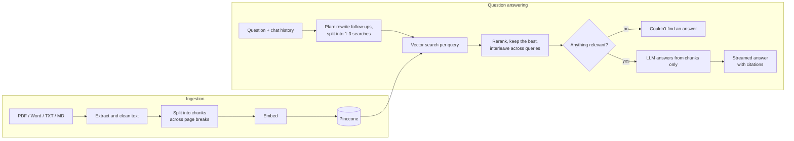

# DocQA: question answering over your own documents

A retrieval-augmented generation (RAG) chatbot. Upload books, articles or research papers (PDF, Word, text or Markdown), ask questions, and get answers that cite the exact passages and pages they came from. If the documents don't contain the answer, it says so instead of guessing.


Built with Python, LangChain, Pinecone and FastAPI, with a plain HTML, CSS and JavaScript frontend. By default it runs entirely on free tiers: Groq for the chat models and Pinecone for embeddings, vector search and reranking. OpenAI can be swapped in through settings.

## Screenshots

**1. Upload.** The app opens by asking what you want to upload: a book, an article or a research paper.


**2. Library.** Uploads are indexed with a progress bar and queue one after another. Each document gets suggested questions generated from its own text.


**3. Cited answers.** Clicking a citation opens the passage it came from. Here only two of five documents are ticked, so the search is limited to them, and the question was split into two searches.


**4. Questions across documents.** One question about two unrelated topics is answered from a book and a research paper together, each part cited separately. Shown in the dark theme.


## How it works



## Features

- **Cited answers**: every answer carries numbered citations; clicking one shows the passage, its file and its page range.
- **Honest refusals**: weak matches are filtered out, and the model is told to refuse when the passages don't answer the question. It answers the part it can when only part is covered.
- **Follow-up questions**: "what about for contractors?" is rewritten into a standalone question before searching.
- **Multi-topic questions**: a question about two subjects, or two documents, is split into one search per topic so each part gets its own evidence.
- **Reranking**: retrieved passages are re-scored against the question by a cross-encoder. If the reranker is unavailable, the app falls back to vector order.
- **A library you control**: tick which documents a question should search, or remove one entirely.
- **Suggested questions**: each upload gets a few example questions generated from its own text, shown as one-click starters.
- **Large uploads**: books are indexed in batches with a progress bar, and an interrupted upload resumes where it stopped.
- **Incremental ingestion**: chunk IDs are derived from file name and content, so re-uploading an unchanged file is skipped and a changed file replaces its old chunks.
- **Word files**: reads `.docx` and legacy `.doc` as well as PDF, text and Markdown.
- **Evaluation script**: measures retrieval, answer accuracy, citation rate and refusal behaviour on a question set.
- **Light and dark themes**, a phone-sized layout, and streamed answers.

## Setup

Requires Python 3.11 or newer (developed on 3.13) and free API keys for [Groq](https://console.groq.com/keys) and [Pinecone](https://app.pinecone.io).

```bash
python -m venv .venv
.venv\Scripts\activate          # macOS/Linux: source .venv/bin/activate
pip install -r requirements.txt
copy .env.example .env          # macOS/Linux: cp .env.example .env
```

Put your two keys in `.env`. The Pinecone index is created automatically on first run.

Free-tier limits to be aware of: Groq caps tokens per minute, so several questions in quick succession slow down while the app waits and retries, and Pinecone's Starter plan includes a limited number of rerank requests per month.

## Usage

Start the web app and open http://localhost:8000 (on Windows, double-clicking `start.bat` does both):

```bash
uvicorn server:app --port 8000
```

Choose whether you're uploading a book, an article or a research paper, drop the files in, and ask questions once indexing finishes. Click a citation such as `[1]` in an answer to see the passage and page it came from.

A simpler Streamlit version of the UI is also included:

```bash
streamlit run app.py
```

You can also index a folder from the command line:

```bash
python -m docqa.ingest data/sample --namespace sample
```

## Evaluation

Two question sets are included:

- `eval/questions.jsonl`: 16 questions on the small sample documents in `data/sample`.
- `eval/library.jsonl`: 38 questions on a mixed library of one book (264 pages), one research paper (14 pages) and one long Word article. It has 34 answerable questions, two of which need two documents, and 4 the documents cannot answer. Each lists the pages a correct answer must come from. The documents themselves are not part of this repository.

```bash
python -m docqa.ingest data/sample --namespace sample
python -m eval.run_eval --namespace sample
python -m eval.run_eval --questions eval/library.jsonl
```

Use `--retrieval-only` to skip answer generation, `--no-rerank` to turn the reranker off, `--top-k` / `--min-score` to compare settings, and `--out eval/results.json` to save per-question results.

### Results on the mixed library

| Metric | Result |
| --- | --- |
| Right page retrieved (`retrieval_hit_rate`) | 34 / 34 |
| Ranking of the right page (`retrieval_mrr`) | 0.944 |
| Expected facts present in retrieved text (`context_recall`) | 34 / 34 |
| Answers containing the expected facts (`answer_accuracy`) | 34 / 34 |
| Answers with a citation (`citation_rate`) | 34 / 34 |
| Unanswerable questions correctly refused | 4 / 4 |
| Answerable questions wrongly refused | 0 / 34 |

Answer accuracy is a keyword check against expected facts, not a human or LLM judgement of the whole answer, and the questions were written by the project author with the documents open, so treat these as a regression check rather than a benchmark.

### What the evaluation changed

- **Chunking across page breaks.** Chunks were first cut page by page, so a definition spanning two pages was split and one question could never be answered from a single passage. Pages are now joined before splitting and each chunk records the page range it covers.
- **Text clean-up.** One PDF contained 790 "fi" ligature characters and others had words hyphenated across lines; both are repaired at ingestion.
- **Search planning.** A question about two topics retrieved passages for only one of them and was refused. Splitting such questions into one search per topic fixed it. An early version of the planning prompt produced two or three near-duplicate searches for simple questions; tightening it brought that down to one.
- **Reranker.** On an earlier, larger test library (three books, about 3,600 passages) reranking raised MRR from 0.87 to 0.97, mostly by pushing table-of-contents and index pages down. On the smaller mixed library above it reordered results but did not change MRR (0.944 with and without).
- **Citation format.** The answer model sometimes cites as `[1†L3-L7]`; these are rewritten to `[1]` as the answer streams.
- **Hybrid search was not added.** Vector search already retrieved the right page for every question, so the evidence did not justify the extra moving parts.

### Metrics

| Metric | Meaning |
| --- | --- |
| `retrieval_hit_rate` | Share of answerable questions where every expected document (and page, if given) was retrieved |
| `retrieval_mrr` | Mean reciprocal rank of the first passage from an expected page |
| `context_recall` | Share of answerable questions where the retrieved text contains the expected facts |
| `answer_accuracy` | Share of answers containing the expected facts |
| `citation_rate` | Share of answers that include a `[n]` citation |
| `false_refusal_rate` | Answerable questions the system refused |
| `correct_refusal_rate` | Unanswerable questions the system correctly refused |

## Tests

The tests replace Pinecone and the LLM with in-memory fakes, so they need no API keys.

```bash
pytest
```

## Project layout

```
server.py           Web app: FastAPI backend and JSON API
web/                Frontend (plain HTML, CSS and JavaScript, no build step)
app.py              Alternative Streamlit UI
docqa/
  config.py         Settings from .env
  store.py          Pinecone index, embeddings and chat model clients
  ingest.py         Load, chunk and upsert documents (also a CLI)
  retriever.py      Vector search, reranking and merging results across queries
  chain.py          Search planning, prompting, cited answers, suggested questions
  word.py           Text extraction for .docx and legacy .doc files
  library.py        Local record of which documents are indexed
eval/               Question sets and evaluation script
data/sample/        Sample documents (fictional company)
docs/               README screenshots
tests/              Offline tests
```

## Configuration

All settings can be overridden in `.env`; see `.env.example`, which also shows the OpenAI variant. `CHAT_MODEL` uses LangChain's `provider:model` form, so switching to another provider means installing its LangChain package and changing one line. Changing `EMBEDDING_MODEL` to one with a different dimension needs a new `PINECONE_INDEX`, and `MIN_SCORE` should be re-tuned because each embedding model scores on a different scale.

## Possible next steps

- Hybrid search (BM25 + vectors), if a library turns up exact-term misses
- Heading-aware chunking for Markdown and PDFs
- LLM-judged faithfulness scoring (for example with Ragas)
- OCR for scanned PDFs
