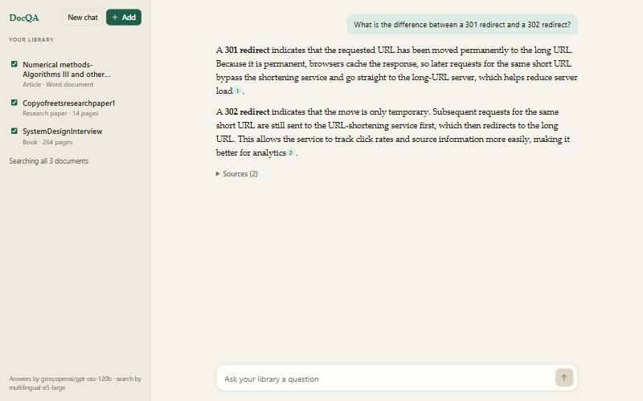
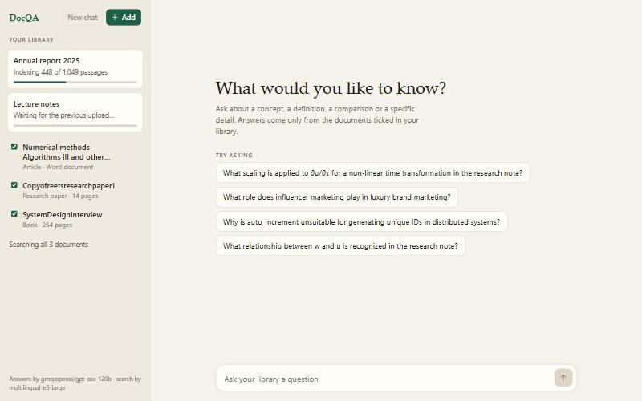
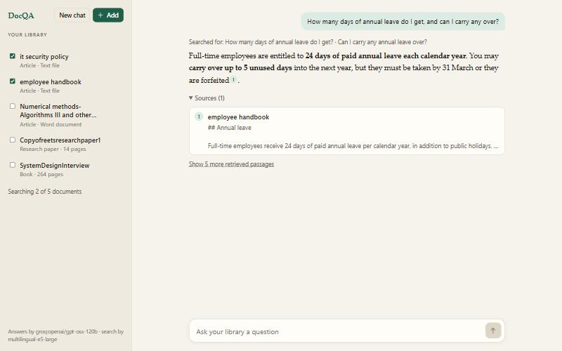
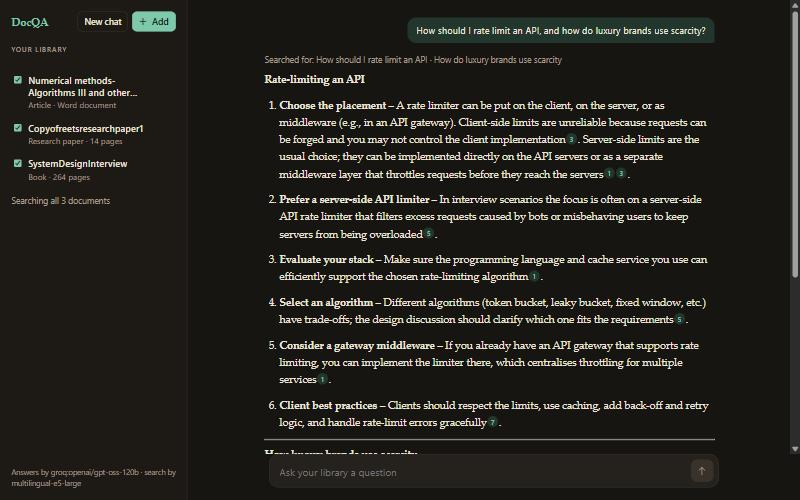
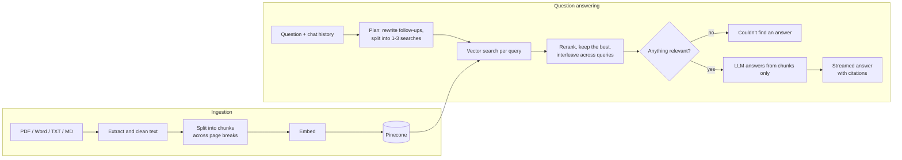

# DocQA

A retrieval-augmented question answering system for your own documents. It answers from the files you upload and cites the page each statement came from.



Upload a book, an article or a research paper. The system extracts the text, splits it into passages and indexes them in a vector database. Questions are then answered from the most relevant passages only, with a numbered citation after each claim. When the documents do not contain the answer, the system says so instead of guessing.

The project began as a standard RAG pipeline: load, chunk, embed, retrieve, generate. Most of what goes beyond that came from testing it on full-length books and correcting the failures that testing exposed. These are documented under [Evaluation](#evaluation).

The default configuration runs entirely on free tiers. Groq serves the language models, and Pinecone provides embeddings, vector search and reranking. The backend is FastAPI with LangChain. The frontend is plain HTML, CSS and JavaScript with no build step.

## Motivation

A general-purpose assistant such as ChatGPT can already answer most questions, so it is reasonable to ask what a system like this adds. The difference lies in where the answer comes from.

A language model on its own answers from what it absorbed during training. It has not read your lecture notes, your organisation's policies or a paper published last month. When it lacks the information it tends to produce a fluent guess, and the answer arrives with no source to check it against.

DocQA uses the model only to read and to write. The facts come from documents you supply, retrieved at the moment the question is asked, and the model is restricted to them.

| | General-purpose LLM | DocQA |
| --- | --- | --- |
| Source of answers | Training data, fixed at a cutoff date | The documents you upload |
| Private or recent material | Unknown to the model | Indexed and searchable |
| Verifiability | No source given | Every claim cites a passage and its page |
| When the answer is not available | May produce a plausible guess | States that the documents do not cover it |
| Document size | Bounded by the context window | Hundreds of pages across many files; only the relevant passages reach the model |
| Control | A fixed product | You choose which documents are searched and which models are used, and each stage can be measured |

Consumer assistants now accept file attachments, and behind that feature is the same technique. For a few questions about a single PDF, that is adequate. Building the pipeline matters in three situations: when the library has to persist and grow, when the choice of model and of where the text is sent has to be yours, and when you need to measure how often the system is right. It is also the architecture organisations use for internal knowledge search, where documents cannot be handed to a public chatbot.

One qualification: in the default configuration, document text is sent to Pinecone and Groq, so this is not an offline system. The language model provider is a configuration setting.

## Usage

### Step 1: Upload a document

With an empty library, the application asks for a file and for its type: book, article or research paper.


### Step 2: Indexing

A full book takes a minute or two to index, so uploads report their progress and queue behind one another. Once a document is indexed, the system samples a few passages from it and generates suggested questions, which gives a starting point for a newly uploaded file.



### Step 3: Ask a question and check the source

Answers are streamed with numbered citations. Selecting a citation opens the passage it refers to, with its file and page range. The checkboxes in the sidebar restrict the search to chosen documents, so one document can be queried without interference from the rest.



### Step 4: Ask across documents

A question is not confined to one document. The example below asks about API rate limiting and about luxury marketing in a single sentence. The system runs a separate search for each part and answers both, citing a system design book for the first and a research paper for the second.



Follow-up questions are resolved against the conversation. After a question about how long a function should be, "what about a class?" is rewritten into a complete question before retrieval.

## Installation

Requirements: Python 3.11 or newer, and two free API keys, one from [Groq](https://console.groq.com/keys) and one from [Pinecone](https://app.pinecone.io).

```bash
python -m venv .venv
.venv\Scripts\activate          # macOS/Linux: source .venv/bin/activate
pip install -r requirements.txt
copy .env.example .env          # macOS/Linux: cp .env.example .env
```

Add the two keys to `.env`, then start the server and open http://localhost:8000. On Windows, `start.bat` does both.

```bash
uvicorn server:app --port 8000
```

The Pinecone index is created on first run. Supported formats are PDF, `.docx`, legacy `.doc`, plain text and Markdown.

The free tiers impose two limits. Groq caps tokens per minute, so several questions in quick succession are delayed while the application waits and retries. Pinecone's Starter plan allows a limited number of rerank requests per month; once they are used up, the application continues with vector ranking alone.

A smaller Streamlit interface is included, along with a command-line entry point for indexing a folder. Streamlit and the test suite are installed from `requirements-dev.txt`:

```bash
pip install -r requirements-dev.txt
streamlit run app.py
python -m docqa.ingest data/sample --namespace sample
```

## Deployment

Run locally, the application keeps a single library on one machine. The same code can be hosted so that other people use it through a link. The repository includes a Render Blueprint (`render.yaml`) for that, and a `Dockerfile` for hosts that run containers.

[](https://render.com/deploy?repo=https://github.com/AashutoshR/docqa-rag)

Render asks for three values during setup: the Groq key, the Pinecone key, and an access code of your choosing. The Blueprint sets the rest.

| Setting | Hosted value | Effect |
| --- | --- | --- |
| `WORKSPACES` | `on` | Each browser gets a private library. Visitors cannot see, search or remove one another's documents. |
| `ACCESS_CODE` | chosen at setup | The API rejects requests without the code, so a leaked link alone does not expose the service or its API quota. |
| `MAX_UPLOAD_MB` | `25` | Upload size limit, sized for the 512 MB free instance. |
| `MAX_DOCUMENTS` | `10` | Documents allowed per library. |
| `PINECONE_INDEX` | `docqa-web` | A separate index from local development. |

Workspaces need no accounts. On first visit the browser generates a random identifier and keeps it in local storage. Every chunk that browser uploads carries the identifier in its ID and metadata, and every search is filtered by it on the server. The list of documents in each library is stored in Pinecone as well, so a restart of the server loses nothing.

This arrangement suits sharing with a small group. It has clear limits:

- A free Render instance sleeps after 15 minutes without traffic, and the next request takes about a minute to wake it.
- All visitors draw on the same Groq and Pinecone free-tier quotas.
- A library belongs to a browser, not a person. Clearing site data, or switching device, starts a new empty library.

Charging for access would require user accounts, per-user quotas and paid model tiers, none of which are implemented.

## Architecture



### Query planning

Before retrieval, a small model receives the question and the conversation so far. It rewrites follow-ups into standalone questions and, where a question covers more than one subject, splits it into separate queries. Each query gets its own vector search, and the results are interleaved so that no subject is crowded out. Planning uses a separate, smaller model than answer generation, which also keeps the answer model within its rate limit.

### Retrieval and reranking

Each search returns 20 candidate passages. A cross-encoder reranker scores them against the query, and the five highest-scoring passages are passed to the answer model.

### Grounded generation

The answer model receives only those passages, numbered. It is instructed to cite a passage number after each claim and to refuse if the passages do not contain the answer. A second safeguard sits in front of it: if no passage clears a similarity threshold, the application returns the refusal directly without calling the model.

### Ingestion

Chunks are allowed to span page breaks, and each records the range of pages it covers. Chunk IDs are a hash of the file name and contents. Uploading the same file twice therefore has no effect, uploading a changed version replaces the earlier passages, and an interrupted upload resumes where it stopped.

## Evaluation

The repository includes an evaluation script and two question sets. `eval/questions.jsonl` covers the two sample documents in `data/sample`. `eval/library.jsonl` contains 38 questions on a mixed library: a 264-page book, a 14-page research paper and a long Word article. Of these, 34 are answerable from the documents (two require two documents at once) and 4 are not. Each question lists the pages a correct answer must draw on. The documents themselves are not part of this repository.

```bash
python -m eval.run_eval --questions eval/library.jsonl
```

| Metric | Result |
| --- | --- |
| Correct page retrieved | 34 of 34 |
| Mean reciprocal rank of the correct page | 0.944 |
| Answer contains the expected facts | 34 of 34 |
| Answer includes a citation | 34 of 34 |
| Unanswerable questions refused | 4 of 4 |
| Answerable questions wrongly refused | 0 of 34 |

These figures carry a caveat. "Contains the expected facts" is a keyword check, not an assessment of the whole answer, and the questions were written with the documents at hand. The set serves as a regression test. It is not a benchmark.

### Findings

Testing on real documents exposed five issues. Each is described with the change it led to.

#### Page-based chunking loses content

A definition that began at the foot of one page and ended on the next was split in two, so no single passage could answer the question about it. Joining pages before splitting resolved this.

#### Extracted PDF text needs cleaning

One book stored 790 "fi" ligatures as a single character, so the word "first" did not match itself. Others contained words hyphenated across line breaks. Both are repaired during ingestion.

#### Multi-topic questions require query decomposition

A question on two topics was initially refused outright: all five retrieved passages came from one topic, the model found nothing on the other, and it declined the whole question. The planning step exists for this case. The first version of the planning prompt overcorrected and issued three near-identical searches for simple questions; a revision reduced that to one.

#### The value of reranking depends on the corpus

On an earlier test set of three books (about 3,600 passages), reranking raised mean reciprocal rank from 0.87 to 0.97, mainly by removing table-of-contents and index pages from the results. On the smaller library above it reordered results, but the score was 0.944 with and without it.

#### Hybrid keyword search was not added

Vector search already retrieved the correct page for every question, so there was no failure for it to correct.

The script accepts `--retrieval-only` to skip answer generation, `--no-rerank` to disable the reranker, and `--out` to save per-question results.

## Testing

```bash
pytest
```

The suite has 52 tests, installed with `requirements-dev.txt`. Pinecone and the language models are replaced with in-memory fakes, so the tests run offline and need no API keys.

## Project structure

```
server.py           FastAPI backend and JSON API
web/                Frontend: HTML, CSS and JavaScript
app.py              Streamlit interface
docqa/
  config.py         Settings, read from .env
  store.py          Pinecone index, embedding, chat and reranking clients
  ingest.py         Text extraction, cleaning, chunking and upload
  retriever.py      Vector search, reranking, merging results across queries
  chain.py          Query planning, prompts, cited answers, suggested questions
  word.py           Text extraction for .docx and legacy .doc
  library.py        The list of documents in each library, stored in Pinecone
eval/               Question sets and the evaluation script
data/sample/        Two short sample documents about a fictional company
tests/              Offline tests
render.yaml         Render Blueprint for hosting
Dockerfile          Container image for other hosts
```

## Configuration

All settings are read from `.env`, and `.env.example` lists the options. Models are specified in LangChain's `provider:model` form, so moving to OpenAI or another provider requires installing its LangChain package and changing one line. An embedding model with a different vector dimension needs a new Pinecone index, and the similarity threshold must be re-tuned, because each embedding model scores on its own scale.

## Limitations and future work

Scanned PDFs are not supported, as there is no OCR stage. Chunking ignores document structure, so a section heading can be separated from its text. The evaluation checks for expected facts only; verifying that every sentence of an answer is supported by its cited sources would require an LLM-based judge, which is the next planned addition.
