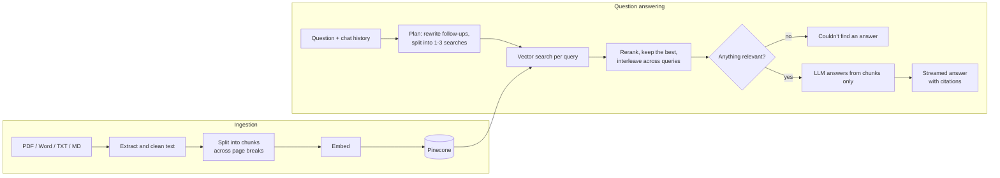

# DocQA

Ask questions about your own PDFs and Word files, and get answers that point to the page they came from.


You upload a book, an article or a research paper. The app splits it into passages and indexes them, and then you ask questions in plain English. Every answer cites its sources, and when the documents don't cover a question it says so instead of making something up.

It started from the usual RAG tutorial shape: load, chunk, embed, retrieve, answer. Most of what's here beyond that came from testing it on real books and fixing the places where it broke. Those are written up [further down](#does-it-work).

Everything runs on free tiers. Groq serves the language models, and Pinecone handles embeddings, vector search and reranking. The backend is FastAPI with LangChain. The frontend is plain HTML, CSS and JavaScript with no build step.

## Using it

With an empty library, the app asks for a file and what kind of document it is.


A full book takes a minute or two to index, so uploads show their progress and queue behind each other. Once a document is in, the app reads a few passages from it and proposes questions you could ask. That helps when you've just uploaded something and don't know where to start.


Answers stream in with numbered citations. Click a number and the passage opens underneath, with its file and page range. The checkboxes in the sidebar decide which documents are searched, so you can question one document without the others getting in the way.


A question doesn't have to stay inside one document. The one below asks about API rate limiting and about luxury marketing in the same sentence. The app runs a separate search for each half and answers both, citing a system design book for the first and a research paper for the second.


Follow-ups work as you'd expect. After a question about how long a function should be, "what about a class?" is rewritten into a complete question before anything is searched.

## Running it

You need Python 3.11 or newer and two free API keys, one from [Groq](https://console.groq.com/keys) and one from [Pinecone](https://app.pinecone.io).

```bash
python -m venv .venv
.venv\Scripts\activate          # macOS/Linux: source .venv/bin/activate
pip install -r requirements.txt
copy .env.example .env          # macOS/Linux: cp .env.example .env
```

Put the two keys in `.env`, then start the server and open http://localhost:8000. On Windows, double-clicking `start.bat` does both.

```bash
uvicorn server:app --port 8000
```

The Pinecone index is created on first run. The app accepts PDF, `.docx`, legacy `.doc`, plain text and Markdown files.

Two limits come with the free tiers. Groq caps tokens per minute, so several questions in quick succession slow down while the app waits and retries. Pinecone's Starter plan allows a limited number of rerank requests each month; when they run out, the app carries on with plain vector ranking.

There is also a smaller Streamlit version of the interface, and a command for indexing a folder without the UI:

```bash
streamlit run app.py
python -m docqa.ingest data/sample --namespace sample
```

## How it works



Before any search runs, a small model looks at the question and the conversation so far. It rewrites follow-ups into standalone questions, and if the question is really two questions it splits them. Each part gets its own vector search, and the results are interleaved so no part is crowded out. This uses a separate, cheaper model than the one that writes answers, which also keeps the answer model under its rate limit.

Each search fetches 20 candidate passages. A cross-encoder reranker scores them against the question and the best five go to the answer model.

The answer model sees only those passages, numbered, and is told to cite a number after each claim and to refuse if the passages don't contain the answer. There is a second guard before it: if nothing clears a similarity threshold, the app returns the refusal itself without calling the model.

Chunks are allowed to run across page breaks, and each one records the range of pages it covers. Their IDs are a hash of the file's name and contents, so uploading the same file twice does nothing, uploading a changed version replaces the old passages, and an upload that gets interrupted picks up where it stopped.

## Does it work?

There is an evaluation script and two question sets. The small one, `eval/questions.jsonl`, covers the two sample documents in `data/sample`. The real one, `eval/library.jsonl`, has 38 questions about a mixed library: a 264-page book, a 14-page research paper and a long Word article. Of those, 34 can be answered from the documents (two need two documents at once) and 4 cannot. Each question lists the pages a correct answer has to come from. The documents themselves aren't in this repository.

```bash
python -m eval.run_eval --questions eval/library.jsonl
```

| | Result |
| --- | --- |
| Right page retrieved | 34 of 34 |
| Mean reciprocal rank of the right page | 0.944 |
| Answer contains the expected facts | 34 of 34 |
| Answer includes a citation | 34 of 34 |
| Unanswerable questions refused | 4 of 4 |
| Answerable questions wrongly refused | 0 of 34 |

These numbers need a caveat. "Contains the expected facts" is a keyword check, not a judgement of the whole answer, and I wrote the questions with the documents open in front of me. It works as a regression test. It is not a benchmark.

The more useful output was the list of things it caught along the way.

Chunking page by page was a mistake. A definition that started at the bottom of one page and finished on the next was cut in half, and no single passage could answer the question about it. Joining the pages before splitting fixed that.

PDF text is dirtier than it looks. One book had 790 "fi" ligatures stored as a single character, so "first" didn't match "first". Others had words hyphenated across line breaks. Both are now repaired during ingestion.

A two-topic question used to be refused outright. All five retrieved passages came from one topic, the model saw nothing about the other, and it declined the whole question. That is what the planning step is for. My first version of the planning prompt overcorrected and issued three near-identical searches for simple questions, so it took a second pass to get it down to one.

The reranker's value depends on the library. On an earlier test set of three books (about 3,600 passages) it lifted mean reciprocal rank from 0.87 to 0.97, mostly by pushing table-of-contents and index pages out of the results. On the smaller library above it reordered results but the score stayed at 0.944 with or without it.

I didn't add hybrid keyword search. Vector search was already finding the right page for every question, so there was no failure for it to fix.

The script takes `--retrieval-only` to skip answer generation, `--no-rerank` to switch the reranker off, and `--out` to save per-question results.

## Tests

```bash
pytest
```

There are 45 tests. They swap Pinecone and the language models for in-memory fakes, so they run offline and need no API keys.

## Layout

```
server.py           FastAPI backend and JSON API
web/                Frontend: HTML, CSS and JavaScript
app.py              Streamlit version of the interface
docqa/
  config.py         Settings, read from .env
  store.py          Pinecone index, embedding, chat and reranking clients
  ingest.py         Reading, cleaning, chunking and uploading documents
  retriever.py      Vector search, reranking, merging results across queries
  chain.py          Search planning, prompts, cited answers, suggested questions
  word.py           Text extraction for .docx and legacy .doc
  library.py        Local record of which documents are indexed
eval/               Question sets and the evaluation script
data/sample/        Two short sample documents about a fictional company
tests/              Offline tests
```

## Settings

Everything is configurable in `.env`, and `.env.example` lists the options. Models are named in LangChain's `provider:model` form, so moving to OpenAI or another provider is a matter of installing its LangChain package and changing a line. If you switch to an embedding model with a different vector size you need a new Pinecone index, and the similarity threshold has to be re-tuned, because every embedding model scores on its own scale.

## What's missing

Scanned PDFs don't work, since there is no OCR. Chunking ignores headings, so a section title can be separated from its text. And the evaluation only checks for expected facts; scoring whether every sentence of an answer is supported by its sources would need an LLM judge, which is the next thing I'd add.
